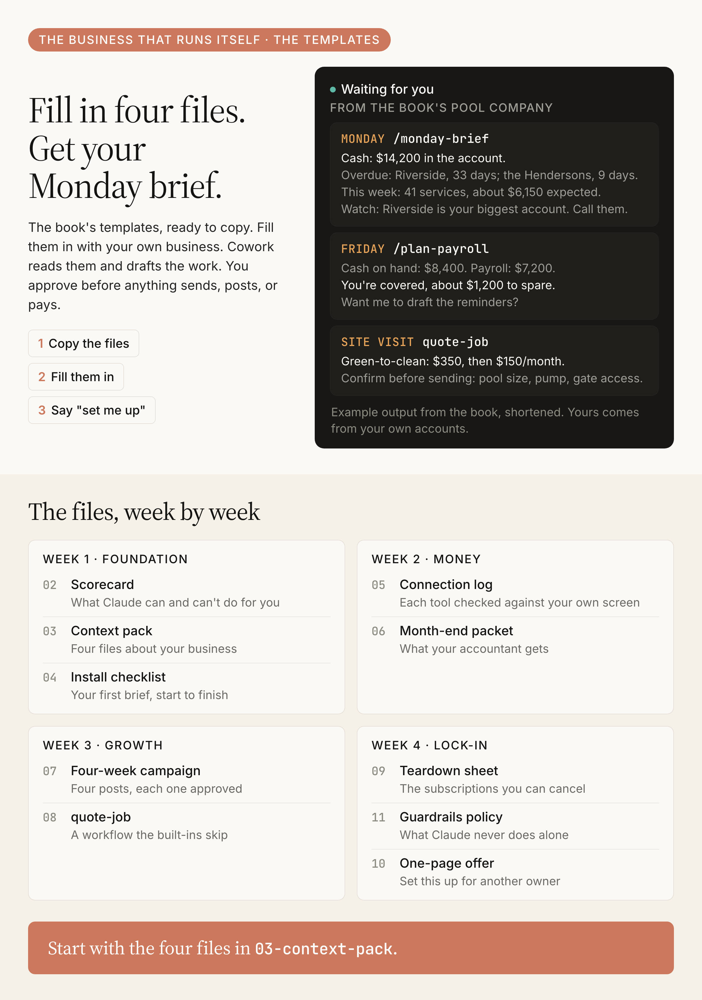

<!-- The front page: what this is, where to start, and which file goes where. Companion to Claude for Small Business - The Business That Runs Itself. -->
# The Business That Runs Itself: the templates

**Your context pack, your guardrails policy and your 30-day rollout, ready to fill in for your own business.**

Companion templates to the book *Claude for Small Business - The Business That Runs Itself*, from [youcanbuildthings.com](https://youcanbuildthings.com).

Copy a file, type your business into it, and Claude uses it. Two words first. The "context pack" is four short files about your business, and [chapter 3's folder](chapters/03-context-pack/) has them. "Cowork" is the Claude desktop app the plugin runs in, and [chapter 4's folder](chapters/04-first-workflow/) gets it running. Anthropic makes the plugin, in [`anthropics/knowledge-work-plugins`](https://github.com/anthropics/knowledge-work-plugins/tree/main/small-business). This repo holds the book's templates.

Templates for learning, not financial, tax, legal or HR advice ([disclaimer](DISCLAIMER.md)). Unofficial: Anthropic didn't write or review this repo.

## Start here

No git needed. On this page, click the green **Code** button, then **Download ZIP**, and unzip it.

**"I'm starting the book now."** Write down the three tasks that eat your week (that's chapter 1). Then make a folder called `My Business Context`, copy the four files from [`chapters/03-context-pack/`](chapters/03-context-pack/) into it, and fill in `services-and-pricing.md` first. Once all four are filled, the next words you type, in Cowork, are `set me up`.

Plugin already installed? Same copy-and-fill, then say `set me up` and hand Cowork the folder.

**"I finished the book and want the files."** Use the table below.

## Which file goes where

| Chapter | File in this repo | Where it goes in your business |
|---|---|---|
| 2 | [`scorecard.md`](chapters/02-what-it-can-do/scorecard.md) | One printed page you keep in sight |
| 3 | [the four context files](chapters/03-context-pack/) | `My Business Context/` |
| 4 | [the install checklist](chapters/04-first-workflow/README.md) | Your notes, ticked off once |
| 5 | [`test-questions.md`](chapters/05-connectors/test-questions.md), [`connection-log.md`](chapters/05-connectors/connection-log.md) | Your notes, one log block per tool |
| 6 | [`month-end-packet.md`](chapters/06-back-office/month-end-packet.md) | A fresh copy each month, to your accountant |
| 7 | [`four-week-campaign.md`](chapters/07-growth/four-week-campaign.md) | Your notes, one row approved per week |
| 8 | [`quote-job/SKILL.md`](chapters/08-custom-workflow/quote-job/SKILL.md), [`design-checklist.md`](chapters/08-custom-workflow/design-checklist.md) | Your own skill, once you've renamed and rewritten it |
| 9 | [`teardown.csv`](chapters/09-saas-teardown/teardown.csv) | Your spreadsheet app |
| 10 | [`one-page-offer.md`](chapters/10-side-income/one-page-offer.md), [`client-intake.md`](chapters/10-side-income/client-intake.md) | A page you send a prospect (optional chapter) |
| 11 | [`guardrails-policy.md`](chapters/11-guardrails/guardrails-policy.md) | `My Business Context/`, next to the four files |
| 12 | [`30-day-calendar.md`](chapters/12-rollout/30-day-calendar.md) | Your wall calendar or whiteboard |

Files with "example" or "book" in the name are the pool company, filled in. Read them for a model. Your folder gets the blank ones.

## The 30 days

| Week | Folders | The file you finish | Done looks like |
|---|---|---|---|
| 1 Foundation | 02, 03, 04 | The four context files | `/monday-brief` matches your real business |
| 2 Money | 05, 06 | One connection log block, the month-end packet | Cash and invoices checked against the real tools |
| 3 Growth | 07, 08 | The four-week campaign, one custom workflow | One customer reply and one post approved; the custom workflow tried on a low-stakes job |
| 4 Lock-in | 09, 11, 10 | The guardrails policy, the teardown sheet | One subscription canceled |

## What it needs

The files open in any browser, text editor or spreadsheet app. The workflows run in your own Cowork app, on a paid Claude plan (Pro and up, per chapter 2), with Anthropic's small-business plugin added.

Thirteen of the names the book prints are gone from the plugin now. The templates use the current names, and [BOOK-FIXES.md](BOOK-FIXES.md) has the full list.

## Contributing

Found something that changed? Open an issue and say what you typed and what you saw. If you can run `gh`, add the command and its output.

## License

MIT, see [LICENSE](LICENSE).
